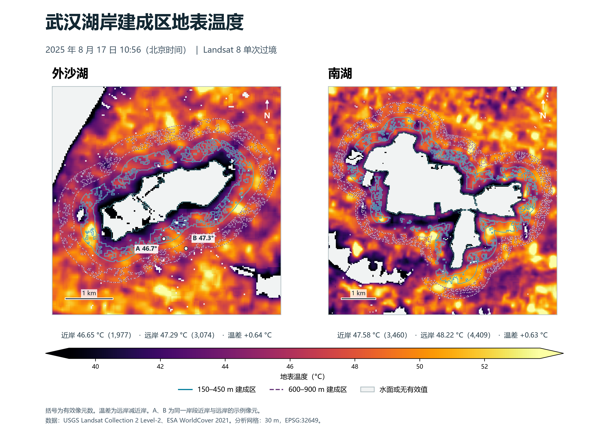

# 武汉湖边的凉意，走出几条街还看得见吗？

2025 年 8 月 17 日 10:56（北京时间）的 Landsat 8 影像显示，**外沙湖和南湖的近岸建成区都比各自的远岸建成区低约 0.64 °C**。外沙湖的温差大约多 0.007 °C，两湖在这次过境中的近岸—远岸反差很接近。南湖两条距离带的建成区平均地表温度均比外沙湖对应距离带高约 0.92–0.93 °C。

## 研究问题与结果

外沙湖和南湖主水面周围，哪个湖的近岸（距岸 150–450 米）与远岸（距岸 600–900 米）建成区地表温差更大？距离按米制投影下到影像水岸的平面距离计算。主指标为远岸均值减近岸均值，正值代表近岸地表较凉。

| 湖泊 | 近岸均值（°C） | 有效像元 | 远岸均值（°C） | 有效像元 | 远岸 − 近岸（°C） |
| --- | ---: | ---: | ---: | ---: | ---: |
| 外沙湖 | 46.653 | 1,977 | 47.295 | 3,074 | +0.641 |
| 南湖 | 47.582 | 3,460 | 48.217 | 4,409 | +0.635 |

四个分区的有效像元比例均为 100%。温差以未四舍五入的均值计算。研究使用单景地表温度，结果描述当次过境的空间差异。绿化、地表材料、建筑形态与阴影都可能影响这个差异，体感温度和近地气温需要另外观测。 [完整统计表](lake_temperature_summary.csv)

## 地图上的证据



左图外沙湖东南岸的 A、B 点位于同一岸段。A 距岸约 **370 米**，地表温度约 **46.65 °C**。B 距岸约 **747 米**，地表温度约 **47.29 °C**。两点按其温度接近各自分区均值且最近岸线位置相近选取，用于展示近岸到远岸的温度差。全区结论来自上表四个分区的像元统计。A、B 的投影坐标、精确距离、原始 DN、`QA_PIXEL` 和换算值都可在证据表中核对。 [SVG 成果地图](wuhan_lake_temperature.svg) · [地图证据点](map_evidence.csv)

## 数据与分析

- Landsat 8 Level-2 景号为 `LC08_L2SP_123039_20250817_20250821_02_T1`。保留 30 米产品网格，使用 `ST_B10` 原始 DN 按 `DN × 0.00341802 + 149.0 − 273.15` 换算地表温度。按 `QA_PIXEL` 位 0–5 和温度填充值排除无效像元。 [USGS 温度产品](https://www.usgs.gov/landsat-missions/landsat-collection-2-surface-temperature) · [USGS 质量位](https://www.usgs.gov/landsat-missions/landsat-collection-2-quality-assessment-bands)
- WorldCover 2021 类别 50 用最近邻对齐到温度网格，再用同景 `QA_PIXEL` 位 7 排除水面，形成建成区面掩膜。土地覆盖底图与影像相差四年，近年用地变化可能影响样本范围。 [ESA WorldCover](https://esa-worldcover.org/en/data-access)
- 使用校准后的同景绿光和短波红外，取 MNDWI 大于 0.10 的连通水面。按影像核定外沙湖和南湖的主水面，在外沙湖大桥处接合两侧水域，以免把桥面误当湖岸。估算水面分别为 2.127、6.714 km²。 [水面与掩膜生成脚本](../workflow/prepare_inputs.py) · [原始数据及其校验值](../data_sources.md)
- DeepSeek Harness 调用 GeoHarness 的 `buffer` 生成四个缓冲面，以 `overlay` 的差集算出两个环带，用 `clip_vector` 裁到建成区，最后用 `zonal_stats` 按像元中心统计。 [完整 DAG](dag.json) · [任务约束](task.json) · [近岸分区](near_zones.gpkg) · [远岸分区](far_zones.gpkg)

## 独立复算

从原始 `ST_B10` 和 `QA_PIXEL` 重新检查像元质量并换算温度，用像元中心与 GeoHarness 输出分区面做相交判断。外沙湖近岸重新得到 **1,977 个像元**和 **46.6533487 °C**，与 GeoHarness 的均值差约 `0.000000004 °C`。另外三个分区也逐一复核，计数一致，均值差均小于 `0.000001 °C`。 [独立复算明细](spot_check.csv)

## 溯源与问题处理

正式运行 `run_id` 为 `58a57d4dbf6640ed8e3b99481a83fb7a`。在溯源 ZIP 中，`reports/0005-verify_dag.json` 是验证记录，`ledger.jsonl` 的第 6 号记录和 `outputs.json` 是执行记录。两者的 `verified_hash` 均为 `72fa82a5b1411ac5b5d068b1c54453a8a09f38e4729f606eb34db37d38558ed1`。静态验证、L4 和溯源链均通过。ZIP 记录输入、输出及校验值，交叉核对时同时保留项目文件。 [正式溯源 ZIP](geoharness_trace.zip) · [DeepSeek Harness 调用日志](deepseek_mcp_calls.jsonl)

1. **模型请求中断。** DeepSeek 模型已在 Harness 中成功调用 `list_operators`，下一轮模型请求返回 `402 Insufficient Balance`。随后用同一套 DeepSeek Harness 的程序化工具接口调用 GeoHarness，完成资产登记、DAG 验证、执行和溯源导出。汇报中应说明正式分析由这个本地工作流驱动。 [模型尝试记录](deepseek_model_attempt.jsonl) · [本地工作流](../workflow/run-geoharness.mjs)
2. **预检写出几何失败。** `overlay(intersection)` 把仅相接的线段和面混在一起，GeoPackage 写出返回 `GeometryTypeValidationError`。改用 GeoHarness 的 `clip_vector` 保留面部分，环带与建成区的面积口径保持一致。
3. **首跑的矩形有效覆盖检查未通过。** 水面被置空时，近、远岸分区的外包矩形有效比例约 78.54% 和 79.47%，低于默认 95%。正式流程保留栅格中的有效水面测温，同时在建成区掩膜排除同景水面。像元计数和均值与首跑一致，矩形检查与四个分区检查在重跑时均通过。 [首跑诊断溯源 ZIP](geoharness_l4_diagnostic.zip) · [首跑调用日志](deepseek_l4_diagnostic.jsonl)

## 复现

在项目根目录运行下列 PowerShell 命令。环境使用已检出的两个仓库，GeoHarness 依赖通过 `uv` 安装，DeepSeek Harness 使用已安装依赖的源码入口。部署到其他路径时，将 [本地工作流配置](../workflow/deepseek-programmatic.patch.yml) 中的插件路径改为该机器上的绝对路径。

```powershell
uv sync --project geoharness --locked --python 3.12 --extra mcp --extra geo
uv run --project geoharness --locked --python 3.12 --extra mcp --extra geo -- python workflow/prepare_inputs.py

$dsh = (Resolve-Path deepseek-harness).Path
$env:TSX_TSCONFIG_PATH = Join-Path $dsh 'tsconfig.json'
$tsx = [uri](Join-Path $dsh 'node_modules/tsx/dist/esm/index.mjs')
node --import $tsx.AbsoluteUri (Join-Path $dsh 'apps/cli/src/bin.ts') --profile headless --patch workflow/deepseek-geoharness.patch.yml --patch workflow/deepseek-programmatic.patch.yml 'Run the configured Wuhan GeoHarness workflow.'
```

用日志中的 `export_trace` 返回路径作为 `workflow/finalize_results.py` 的参数，经 `uv run --project geoharness --locked --python 3.12 --extra mcp --extra geo --with matplotlib -- python` 运行即可重新做独立复算、校验并出图。单独检查溯源包时，可运行 `uv run --project geoharness --locked --python 3.12 --extra mcp --extra geo -- python -m geoharness.mcp.trace verify results/geoharness_trace.zip`。
